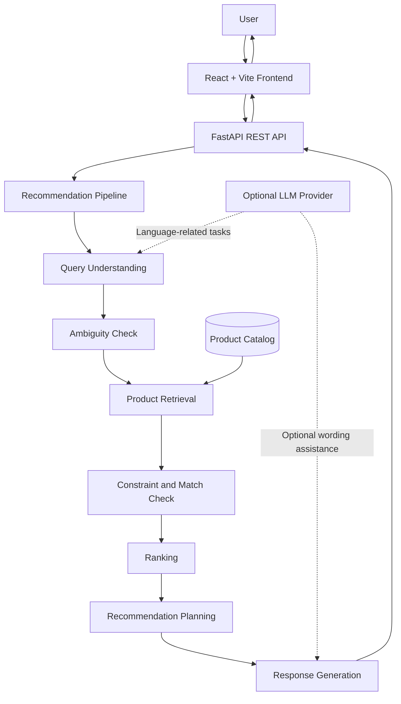
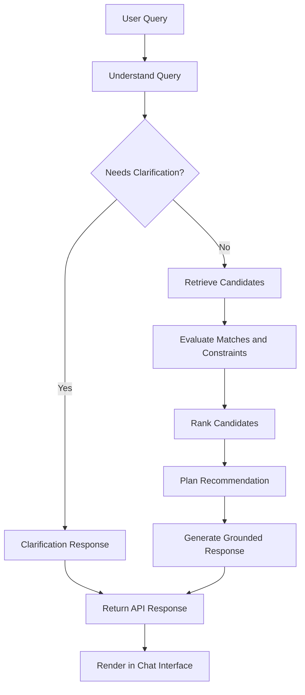

# Conversational Product Recommender

An AI-powered shopping assistant that helps users discover relevant products through natural-language conversations, budget preferences, and product requirements.

**Built with FastAPI, React, Python, and optional LLM integration.**

<p align="center">

  <a href="https://conversational-product-recommender-5.onrender.com">Live Demo</a> ·
  <a href="https://conversational-product-recommender-2.onrender.com/docs">API Documentation</a> ·
  <a href="https://conversational-product-recommender-2.onrender.com/health">API Health</a>

</p>

---

## Overview

Traditional product search often requires users to know the exact product name, apply filters manually, and compare results themselves.

This project explores a conversational alternative. Users can describe what they need in everyday language, and the system processes their request through a recommendation pipeline to identify relevant products and explain its suggestions.

For example:

> "I need running shoes under $80 for rainy weather."

The system analyzes the request, retrieves relevant products, evaluates their suitability, considers budget constraints, and generates a readable recommendation.

The project uses a hybrid approach: deterministic Python logic handles important recommendation decisions, while an optional Large Language Model (LLM) supports language-related tasks. This design aims to make recommendations more explainable and reduce unsupported claims.

**Note:** The current product catalog contains synthetic demonstration data. Recommendations are for demonstrating the system's functionality, not for representing live inventory or verified retail offers.

## Key Features

- **Natural-language shopping:** Accepts conversational product requests instead of requiring exact product names.
- **Query understanding:** Identifies relevant product categories, budget information, and user preferences.
- **Ambiguity handling:** Can identify requests that need clarification before proceeding.
- **Product retrieval:** Combines product-type relevance with text similarity to find candidate products.
- **Constraint-aware recommendations:** Evaluates product requirements and handles strict budget or category mismatches.
- **Ranking and comparison:** Ranks candidate products using relevance, requirements, budget, preferences, and available quality signals.
- **Explainable results:** Presents product details, prices, and reasons for recommendations based on available data.
- **Alternative suggestions:** Supports recommendations for alternatives or upgrades when suitable candidates exist.
- **Grounded response generation:** Separates recommendation decisions and product facts from optional LLM-generated wording.
- **REST API:** Exposes the recommendation system through FastAPI.
- **Web interface:** Provides a React-based chat experience.
- **Containerization:** Supports local multi-service execution through Docker Compose.
- **Testing and observability support:** Includes automated tests and optional tracing integrations.

## System Architecture

The application separates the user interface, API layer, recommendation pipeline, and supporting services.



### Recommendation Request Flow

A typical request moves through these stages:

1. **Input:** The user submits a shopping request through the chat interface.
2. **Query understanding:** The system extracts the request's meaning, product category, budget, and relevant preferences.
3. **Ambiguity check:** The system determines whether the request is sufficiently clear to proceed.
4. **Retrieval:** Candidate products are identified using product-type relevance and text similarity.
5. **Match and constraint checks:** Candidate products are evaluated against important requirements.
6. **Ranking:** Suitable candidates are ordered using recommendation signals.
7. **Recommendation planning:** The system selects products and considers alternatives where appropriate.
8. **Response generation:** Product facts and recommendation decisions are converted into a readable answer.
9. **Display:** The API returns a structured response that the frontend renders for the user.



## Technology Stack

| Area | Technology |
|---|---|
| Backend API | Python, FastAPI |
| Frontend | React, Vite, JavaScript |
| Product retrieval | TF-IDF and product-type relevance |
| Recommendation logic | Python-based rules, constraints, and ranking |
| Language-model integration | Optional LLM through an OpenAI-compatible client |
| Product data | Synthetic CSV catalog and processed JSON data |
| Testing | pytest and frontend test tooling |
| Deployment | Render |
| Containerization | Docker and Docker Compose |
| Optional integrations | Web enrichment and tracing |

## How the Recommendation Engine Works

The engine is designed as a multi-stage pipeline rather than a single LLM prompt.

### 1. Query Understanding

The system interprets the user's request and identifies relevant information such as product type, price limits, and intended use.

### 2. Ambiguity Handling

If a request does not provide enough information to make a meaningful recommendation, the system can request clarification instead of blindly guessing.

### 3. Product Retrieval

The retriever identifies candidate products using product-type matching and TF-IDF text similarity.

TF-IDF helps measure textual relevance. It is not a guarantee that a product satisfies every real-world requirement.

### 4. Constraint Checking and Ranking

The recommendation pipeline evaluates candidates against user requirements and ranks them using available signals. Important constraints are handled separately from ordinary ranking preferences so that a high similarity score does not automatically make an unsuitable product a valid match.

### 5. Response Generation

The response generator builds a user-facing explanation from recommendation results and product information. An optional LLM can assist with language, but product claims should remain grounded in the available data.

### Why use a hybrid approach?

An LLM is useful for understanding natural language and producing fluent responses. However, price comparisons, product matching, and strict requirements benefit from explicit application logic.

Combining these approaches gives the application more control over its recommendations than relying on an LLM alone. It reduces the risk of unsupported claims but does not guarantee that every recommendation will be correct.

## Project Structure

The repository is organized into frontend, backend, data, and deployment components.

```text
conversational-product-recommender/
├── backend/
│   ├── app/
│   │   ├── main.py
│   │   └── services/
│   │       ├── pipeline.py
│   │       ├── query_understanding.py
│   │       ├── ambiguity.py
│   │       ├── retriever.py
│   │       ├── ranker.py
│   │       ├── recommender.py
│   │       ├── response_generator.py
│   │       ├── llm_client.py
│   │       ├── attribute_extractor.py
│   │       ├── upsell.py
│   │       ├── review_analyzer.py
│   │       ├── web_enrichment.py
│   │       └── tracing.py
│   └── requirements.txt
├── frontend/
│   ├── src/
│   ├── package.json
│   └── ...
├── data/
│   ├── amazon_dataset_synthetic_100.csv
│   └── SYNTHETIC_DATA.md
├── docker-compose.yml
├── .gitignore
└── README.md
```

*This is a high-level overview. Some files and supporting directories may be omitted. Verify the current repository before relying on this tree as an exhaustive listing.*

## Getting Started

### Prerequisites

- Git
- Python 3.12
- Node.js and npm
- Docker Desktop with Docker Compose, if using the containerized setup

### Option 1: Run with Docker Compose

Clone the repository:

```bash
git clone https://github.com/Maida-08/conversational-product-recommender.git
cd conversational-product-recommender
```

Build and start the services:

```bash
docker compose up --build
```

Open the local application and API:

- Frontend: `http://localhost:8080` (if using the project's current Compose port mapping)
- Backend API: `http://localhost:8000`
- Swagger documentation: `http://localhost:8000/docs`

Stop the services:

```bash
docker compose down
```

### Option 2: Run the Backend and Frontend Separately

Clone the repository and navigate to its root directory:

```bash
git clone https://github.com/Maida-08/conversational-product-recommender.git
cd conversational-product-recommender
```

Create and activate a Python virtual environment:

```powershell
cd backend
py -3.12 -m venv .venv
.\.venv\Scripts\Activate.ps1
python -m pip install -r requirements.txt
```

Start the backend:

```powershell
python -m uvicorn app.main:app --reload --port 8000
```

In a second terminal, navigate to the frontend directory:

```powershell
cd frontend
npm install
npm run dev
```

Open the Vite URL printed in the terminal, usually `http://localhost:5173`.

**Configuration note:** The frontend must be configured to call the local backend. Check the frontend environment configuration and `src/services/api.js` if requests fail.

## Configuration and Environment Variables

Some integrations are optional and may require environment variables.

- Configure the LLM provider and API key only if using the LLM features.
- Configure a web-search API key only if web enrichment is enabled.
- Configure tracing credentials and project settings only if tracing is enabled.
- Keep API keys in environment variables or a local environment file excluded from Git.

Do not commit API keys, `.env` files containing secrets, or provider credentials. Check the project's actual configuration and deployment settings for the exact variable names required by your setup.

The application can run with different integration settings; enabled features depend on the configured environment.

## API Endpoints

| Method | Endpoint | Purpose |
|---|---|---|
| `GET` | `/health` | Check application health and configuration status |
| `POST` | `/api/v1/chat` | Submit a chat request to the recommendation pipeline |
| `GET` | `/docs` | Explore the API through Swagger UI |

### Try the API

Open the interactive documentation:

[Swagger UI](https://conversational-product-recommender-2.onrender.com/docs)

Use the chat endpoint to submit a shopping request. The precise request fields and response schema are defined by the API and can be inspected in Swagger.

## Testing

The backend uses pytest to test recommendation behavior and supporting services.

From the backend directory, run:

```powershell
python -m pytest
```

Run a focused test module when debugging a particular component:

```powershell
python -m pytest tests/test_retrieval.py
```

Use the actual test paths available in the current repository if they differ from these examples.

Tests are especially valuable for checking product relevance, budget handling, alternatives, response generation, and behavior when no suitable product exists.

## Deployment

The application is hosted on Render.

- **Frontend:** https://conversational-product-recommender-5.onrender.com
- **Backend:** https://conversational-product-recommender-2.onrender.com
- **API documentation:** https://conversational-product-recommender-2.onrender.com/docs
- **Health endpoint:** https://conversational-product-recommender-2.onrender.com/health

The frontend must point to the deployed backend, and the backend must allow requests from the deployed frontend origin. Deployment availability and optional integration status can change, so use the links above to verify the current state.

Free hosting plans may spin down after periods of inactivity, which can make the first request slower.

## Limitations and Future Improvements

Potential next steps include:

- Improve semantic retrieval with embeddings and evaluate it against TF-IDF.
- Expand the catalog with verified product data and more detailed attributes.
- Strengthen evaluation for strict requirements, ambiguous requests, and unsupported product claims.
- Improve recommendation explanations and confidence calibration.
- Add structured offline evaluation metrics for retrieval and ranking quality.
- Add caching, latency measurements, and performance testing.
- Improve frontend presentation and accessibility.
- Expand automated tests for edge cases and regression prevention.

## Author

**Maida Kanwal**

Software Engineering student interested in AI/ML, LLM applications, and backend development.

- GitHub: [Maida-08](https://github.com/Maida-08)
- Project: [Conversational Product Recommender](https://github.com/Maida-08/conversational-product-recommender)

---

*Built as an AI/ML portfolio project to explore conversational product discovery, hybrid recommendation pipelines, and grounded LLM-assisted responses.*
